<p align="center">
  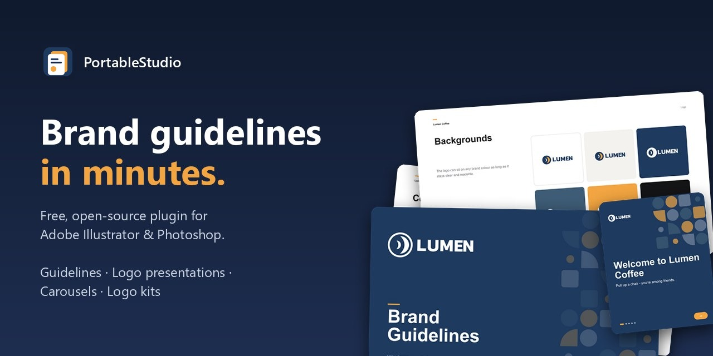
</p>

<h1 align="center">PortableStudio: Brand Guidelines Generator for Adobe Illustrator &amp; Photoshop</h1>

<p align="center">
  <b>Free, open-source Illustrator and Photoshop plugin that creates brand guidelines, logo presentations,
  Instagram carousels and complete logo kits from templates, in minutes instead of days.</b>
</p>

<p align="center">
  <a href="https://github.com/vicenet/PortableStudio/releases/latest"></a>
  <a href="https://github.com/vicenet/PortableStudio/releases"></a>
  <a href="LICENSE"></a>
  
  
  
  <a href="https://github.com/vicenet/PortableStudio/actions/workflows/ci.yml"></a>
  <a href="https://scorecard.dev/viewer/?uri=github.com/vicenet/PortableStudio"></a>
</p>

<p align="center">
  <a href="https://github.com/vicenet/PortableStudio/releases/latest"><b>Download</b></a> ·
  <a href="#features">Features</a> ·
  <a href="#brand-guidelines-template">Templates</a> ·
  <a href="docs/TEMPLATE-GUIDE.md">Make your own templates</a> ·
  <a href="docs/MCP.md">Use with Claude (MCP)</a>
</p>

---

<p align="center">
  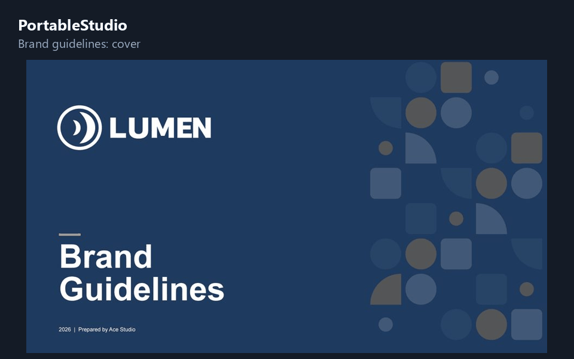
</p>

**PortableStudio** is a free **Adobe Illustrator plugin** and **Photoshop extension** for designers who build
brand identities. Design a **brand guidelines template** once (or use the free ones included), and
PortableStudio fills it with any client's brand name, colours, fonts, logos, photos and copy. You get an
**editable Illustrator file** plus a ready-to-send **PDF brand book**, **logo presentation**, **social
media carousel** and **logo export kit**.

It's a free, open-source alternative to paid brand guideline plugins and template kits: no subscription,
no watermark, and the files are yours.

## Download

| Platform | File | Install |
|---|---|---|
| **Windows 10/11** | [`PortableStudio-setup.exe`](https://github.com/vicenet/PortableStudio/releases/latest) | Run the installer (no admin rights needed) |
| **macOS** (Intel & Apple silicon) | [`PortableStudio.pkg`](https://github.com/vicenet/PortableStudio/releases/latest) | Open the package and follow the steps |
| **Any ZXP installer** | [`PortableStudio.zxp`](https://github.com/vicenet/PortableStudio/releases/latest) | Signed Adobe extension |

Then restart Illustrator/Photoshop and open **Window › Extensions › PortableStudio**
(Photoshop: **Window › Extensions (Legacy)**). Requires Illustrator 2021+ and/or Photoshop 2021+.

If it saves you time, a ⭐ on this repo helps other designers find it.

## Brand guidelines template

The free **Essential Brand Guidelines** template creates a complete **43-page brand book**: brand
overview, mission and values, tone of voice, logo usage, **logo construction grid**, clearspace,
minimum size, logo misuse, colour palette with HEX/RGB/CMYK, tints, gradients, typography, brand pattern,
stationery, photography and applications.

<p align="center">
  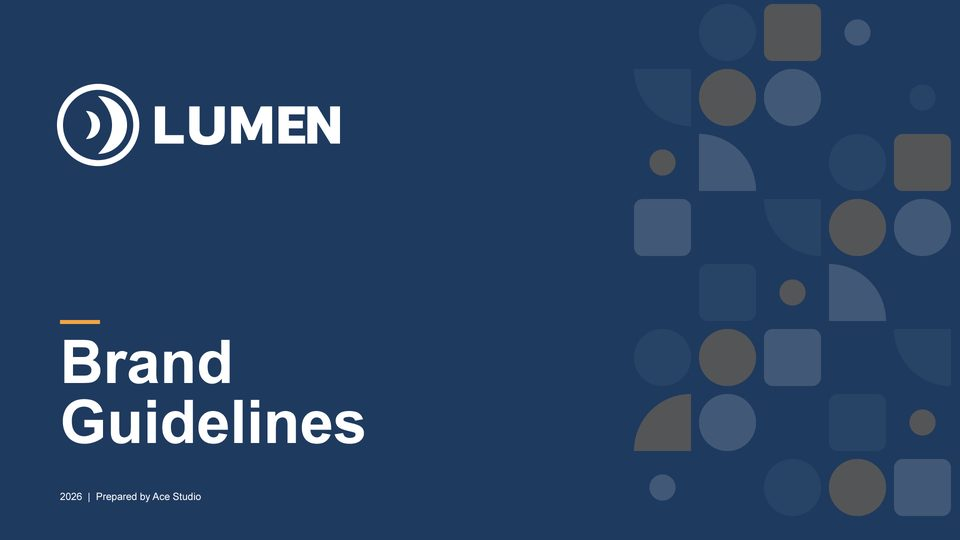
  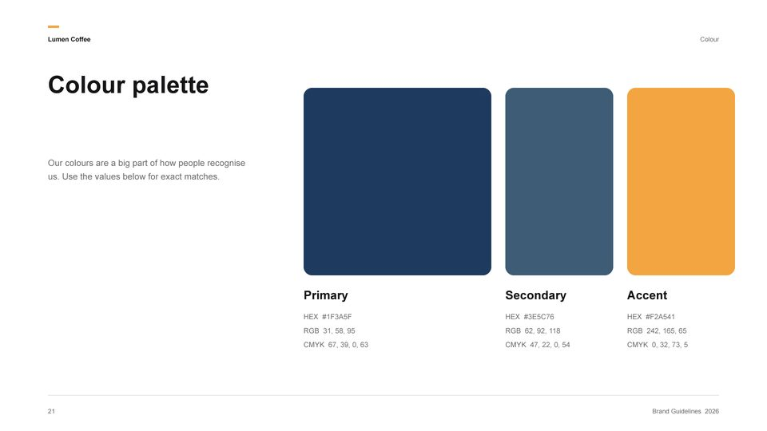
  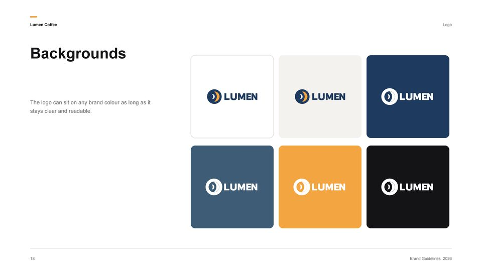
  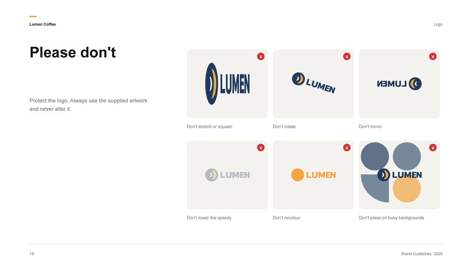
  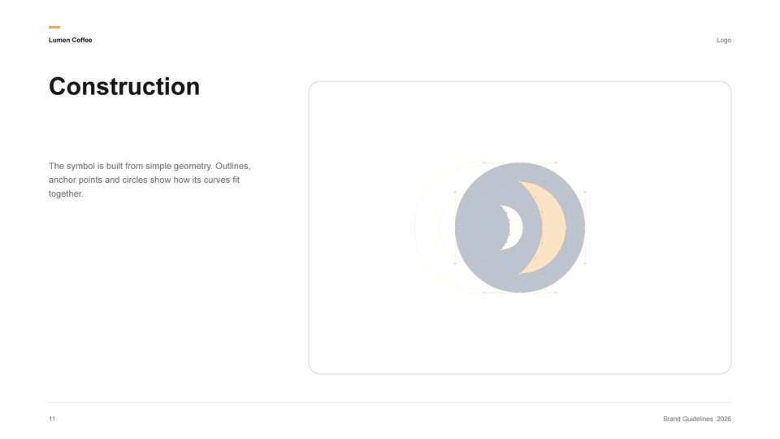
  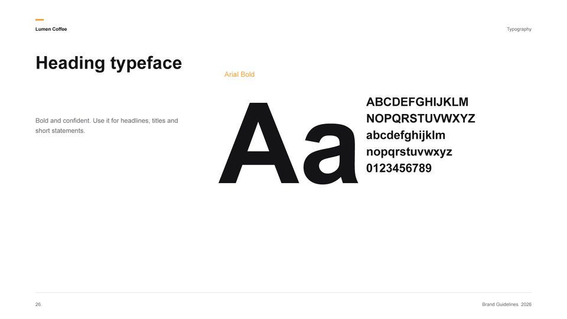
</p>

## Logo presentation template

A 12-page **logo presentation** for client pitches: the idea, the symbol, construction, colour versions,
palette, the logo in use (profile picture, app icon, business card), pattern, website and typography.

<p align="center">
  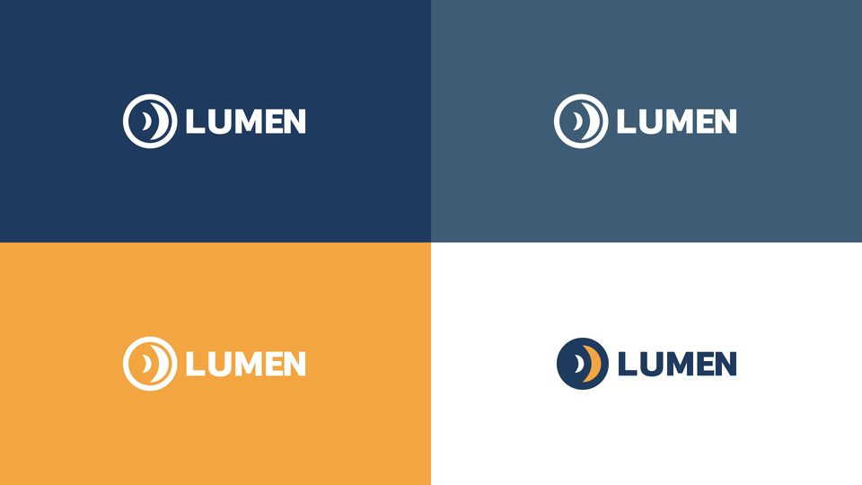
  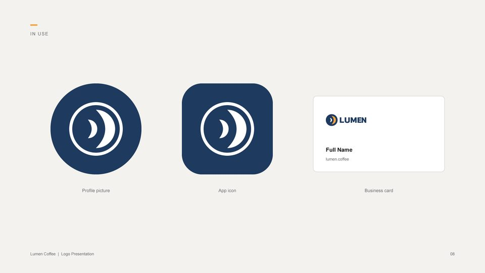
</p>

## Instagram carousel template

A 5-slide **Instagram carousel** (1080×1350) filled from the brand copy, exported as one PNG per slide,
ready to post.

<p align="center">
  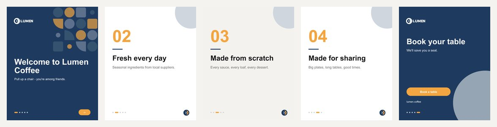
</p>

*All examples above were generated from the included sample brand, "Lumen Coffee".*

## Features

- **Template engine for Illustrator and Photoshop.** Tag any design with `{{brand.name}}`, global
  swatches, Heading/Body styles and logo placeholders; PortableStudio fills text, colours, fonts, logos
  and photos automatically.
- **Update generated documents.** Change the brand later and re-apply it without losing manual edits.
- **Logo export kit.** SVG, EPS, PDF and PNG in full colour, black, white and brand colour, plus
  favicons (favicon.ico, Apple touch and Android icons) and social media profile pictures and banners.
- **Logo construction grids.** Outlines, anchor points, bezier handles, circles, gridlines and clearspace
  on any vector logo.
- **Colour palette tools.** Extract a palette from a logo, industry palettes, tints and shades, CMYK
  conversion and WCAG contrast checks.
- **Brand copy.** Headline, mission, values, tone of voice and carousel text from industry starter copy,
  or written by AI with your own Anthropic API key.
- **Smart fitting.** PNG logos are trimmed and recoloured, long text shrinks to fit its box, and photos are
  cropped to their frames.
- **Brand profiles and batch export.** Save every client once and generate many templates in one click.
- **Template packs.** Install `.zip` template packs, or publish and sell your own.
- **Automation.** A local REST API and an **MCP server** for Claude Desktop and Claude Code.

## How it works

1. **Design and tag.** Build a template in Illustrator or Photoshop and tag what should change
   ([template guide](docs/TEMPLATE-GUIDE.md)), or use the free starter templates.
2. **Add the brand.** Name, colours, fonts, logos, photos and copy, saved as a reusable brand profile.
3. **Generate.** Get an editable `.ai`/`.psd`, a PDF and per-page PNGs. Edit freely, then **Update** to
   apply brand changes.

## For developers

```bash
git clone https://github.com/vicenet/PortableStudio.git
cd PortableStudio
npm install
powershell -ExecutionPolicy Bypass -File scripts\dev-install.ps1   # Windows
sh scripts/dev-install.sh                                           # macOS
npm test
npm run package                                                     # release builds in dist/
```

The project is plain JavaScript (Adobe CEP panel + Node) and ExtendScript, with no framework. See
[CONTRIBUTING.md](CONTRIBUTING.md), [docs/API.md](docs/API.md) and [docs/MCP.md](docs/MCP.md).
Signed installers: [docs/SIGNING.md](docs/SIGNING.md). Adobe Exchange listing: [docs/ADOBE-EXCHANGE.md](docs/ADOBE-EXCHANGE.md).
Releases are built by GitHub Actions: bumping the version in `package.json` on `main` tags and releases
it, building the Windows `.exe`, macOS `.pkg` and macOS zip. Pushing a `v*` tag does the same. The signed
`.zxp` and Windows zip need the local signing certificate, so upload them from `npm run package`.

```
index.html, css/, js/   Panel UI (Adobe CEP: Chromium + Node.js)
host/                   ExtendScript for Illustrator / Photoshop
core/                   Shared Node modules: API, brands, packs, colour, copy
builders/               Scripts that draw the starter templates
templates/              Template library
installer/              Windows (Inno Setup) and macOS (pkgbuild) installers
mcp/server.js           MCP server
```

## FAQ

**Is PortableStudio free?** Yes. It's free and open source (GPL-3.0), and the starter templates are CC0,
so you can use them in commercial client work without attribution.

**Can I use my own brand guidelines template?** Yes. Tag your Illustrator or Photoshop file following the
[template guide](docs/TEMPLATE-GUIDE.md) and add it to the library.

**Does it work with Photoshop?** Yes: text, colours, fonts, logos (including smart-object mockups) and
per-artboard carousel export. Logo kits and construction grids are Illustrator features.

**Why does Windows/macOS warn when installing?** The installers aren't signed with paid developer
certificates yet. They're built by GitHub Actions from this public source code.

## Licence

Found a security problem? See [SECURITY.md](SECURITY.md). [Privacy](PRIVACY.md): no account, no tracking.

**Need grids too?** [PortableGrid](https://github.com/vicenet/PortableGrid) adds column, baseline and golden-ratio
grids, magazine layouts and social safe zones, and can use your PortableStudio brands.

Code: [GPL-3.0](LICENSE). Starter templates and sample brand: [CC0](templates/LICENSE.md). Template packs
by others are licensed by their authors. PortableStudio is an independent project, not affiliated with
Adobe. Illustrator and Photoshop are trademarks of Adobe Inc.

[](https://m8ven.ai/mcp/vicenet-portablestudio-1pn5eu?s=readme)

⭐ **If PortableStudio saves you time, star the repo.** It helps other designers find it.
